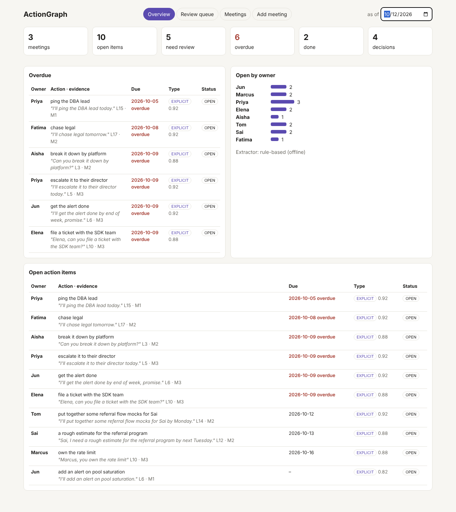
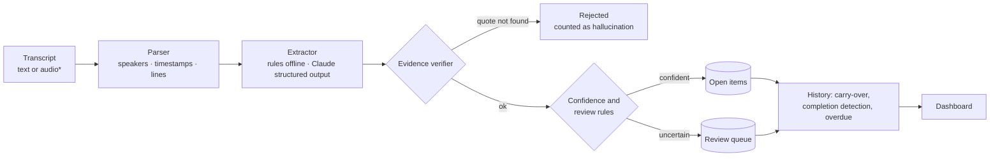

# ActionGraph

**Turns messy meeting transcripts into decisions, owned action items, deadlines and blockers. Every item is backed by an exact quote, and anything uncertain goes to a human.**

Java 21 · Spring Boot 3.5 · Spring AI 1.1 structured outputs (Claude optional) · offline by default.



---

## The problem with "summarize my meeting"

A free-form LLM summary of a meeting reads well and is hard to trust. You can't tell which "action items" someone actually committed to, which were just ideas, and which the model made up. ActionGraph treats extraction as a structured-data problem:

| Requirement | Implementation |
|---|---|
| **Structured schema, not prose** | `action · owner · deadline · type (EXPLICIT/IMPLICIT) · confidence · evidence quote · line`, plus decisions and blockers. With Claude, Spring AI's `.entity(...)` structured output fills the schema directly |
| **Explicit vs. implicit commitments** | *"I'll send the deck by Friday"* is EXPLICIT. *"I'll take a look"*, *"maybe I should…"* and *"I can do it if nobody else has time"* are IMPLICIT |
| **Commitments that span turns** | "Elena, could you add a test?" followed by Elena's "Sure, by Thursday" gives Elena an item due Thursday. Requests that get declined produce no item |
| **No hallucinated items** | `EvidenceVerifier`: the quote must exist in the transcript. If it's on another line, the line is corrected. A paraphrase goes to review, and anything else is **rejected** |
| **Confidence-driven review** | Soft commitments, low confidence, paraphrased evidence, owners who weren't in the meeting and deadlines already past all go to a review queue |
| **Memory across meetings** | Meetings in the same series carry open items forward. When the owner says it's done ("Postmortem is published"), the item closes with that quote as proof. Promises like "I'll get it done Friday" don't count as completions |
| **Deadline resolution** | "by Friday", "EOD", "next Wednesday", "end of next week", "the 20th" and "Oct 14" all resolve against the meeting date |
| **False-positive filters** | Past work ("I already sent it"), refusals, negations, capability statements ("I could add…"), owner-less suggestions ("someone should…") and in-meeting actions ("let me share my screen") are filtered out |


<sub>*Audio needs a diarised speech-to-text provider behind the `SpeechToText` interface; none is bundled.</sub>

## Results

<!-- RESULTS:START -->
Extractor: rule-based (offline)

| Set | Meetings | Items P / R / **F1** | Explicit P / R / **F1** | Implicit P / R / **F1** | Decisions F1 | Deadline acc. | Hallucination rate | Routed to review | Auto-accept precision |
|---|---|---|---|---|---|---|---|---|---|
| synthetic | 200 | 1.00 / 0.98 / **0.992** | 1.00 / 0.98 / **0.988** | 1.00 / 1.00 / **1.000** | 1.000 | 1.000 | 0.000 | 29.1% | 1.000 |
| hand-written dev set | 3 | 1.00 / 1.00 / **1.000** | 1.00 / 1.00 / **1.000** | 1.00 / 1.00 / **1.000** | 1.000 | 1.000 | 0.000 | 29.4% | 1.000 |
| **blind set** (held out) | 3 | 1.00 / 0.80 / **0.889** | 1.00 / 0.67 / **0.800** | 0.75 / 1.00 / **0.857** | 0.667 | 0.857 | 0.000 | 33.3% | 1.000 |

Evidence verifier stress test: rejected **100%** of 200 fabricated quotes, falsely rejected 0.0% of 3626 exact quotes, flagged 100% of 2263 one-word paraphrases for review.

Gold counts: synthetic 1010 items (721 explicit / 289 implicit); dev set 17 (12 / 5); blind set 15 (12 / 3).

Errors on the blind set (FP = extracted but wrong, FN = missed):

- FN lines [6] [Grace, EXPLICIT] app store screenshots (Mobile release huddle)
- FN lines [7, 8] [Omar, EXPLICIT] double check the deep link (Mobile release huddle)
- FN lines [12] [Rui, EXPLICIT] send the icon exports (Design review: settings page)

_Regenerate with the eval command below. Raw output: [`eval/results/`](eval/results/)._
<!-- RESULTS:END -->

**How to read this**

- **The synthetic set is large but template-generated.** 200 meetings and about 1,000 items, padded with distractors (refusals, past work, hypotheticals, small talk). It checks for regressions, and since the extractor and the generator share an author, it overstates real-world accuracy.
- **The dev set is three hand-written meetings.** I designed the rules while reading them, so a 1.0 there means nothing beyond "the rules do what they were designed to do".
- **The blind set is the honest number.** Three meetings written in different styles (timestamps, `Name - text`, slang, continuation lines) after the extractor was finished, then run exactly once. It misses *"I've got the screenshots, leave it with me"*, a request without a comma after the name, and a commitment that mentions "last week". That's the long tail where an LLM extractor earns its cost.
- **The offline extractor's hallucination rate is 0 by construction.** It only quotes the transcript. The verifier stress test shows the safety net that matters for the LLM extractor: it rejects all fabricated quotes and never rejects an exact one.
- **Auto-accept precision is the share of items that skipped review and were correct.** That number is what lets you trust the dashboard without reading every item.

## Quick start

```bash
mvn spring-boot:run          # http://localhost:8080 — three example meetings are pre-loaded
```

```bash
curl -s localhost:8080/api/meetings -H 'Content-Type: application/json' -d '{
  "title": "Team sync", "date": "2026-10-12", "series": "platform",
  "transcript": "Priya: Marcus, can you send the rate limit design doc by Thursday?\nMarcus: Sure, will do.\nElena: I will take a look at the flaky test when I get a chance."
}' | jq '.itemIds'

curl -s 'localhost:8080/api/items?status=NEEDS_REVIEW'
curl -s 'localhost:8080/api/items?overdue=true&asOf=2026-10-20'
curl -s -X POST localhost:8080/api/items/M4-A2/review -H 'Content-Type: application/json' -d '{"approve":true}'
curl -s 'localhost:8080/api/dashboard?asOf=2026-10-12'
```

### With Claude

```bash
export LLM_PROVIDER=anthropic ANTHROPIC_API_KEY=sk-ant-...
mvn spring-boot:run
```

`LlmExtractor` sends numbered transcript lines and gets back typed records via structured output. The same verifier and review rules apply, so the hallucination-rate column becomes a live measurement.

## Evaluation

```bash
mvn -q compile exec:java            # synthetic (200 meetings) + dev set + blind set + verifier stress test
mvn -q compile exec:java -Dexec.args="1000"
```

Matching is one-to-one on **owner + evidence line**. A request/acceptance pair may be cited on either line. P, R and F1 are reported separately for EXPLICIT and IMPLICIT. A correct item with the wrong type counts as a type confusion. `EvalGateTest` enforces F1 floors and the verifier guarantees in CI.

## API

| Method | Path | |
|---|---|---|
| `POST` | `/api/meetings` | `{title, date, series?, transcript}` → extracted meeting |
| `POST` | `/api/meetings/audio` | multipart audio. Returns 501 until a `SpeechToText` provider is configured |
| `GET` | `/api/meetings`, `/api/meetings/{id}` | Meetings with decisions, blockers, carried-over and completed items |
| `GET` | `/api/items` | `owner`, `status`, `overdue`, `asOf` |
| `POST` | `/api/items/{id}/review` | `{approve, owner?, deadline?, action?}` (approve or correct, or reject) |
| `POST` | `/api/items/{id}/done` | Mark done |
| `GET` | `/api/dashboard` | Counts, overdue, open by owner |

## Limitations and next steps

- **Storage is in-memory.** Meetings and items would move to Postgres. The `series` concept maps to a recurring calendar event.
- **Items aren't de-duplicated across meetings.** "Add an alert" in week 1 and "get the alert done" in week 2 stay as two items. The fix is to link new items to similar open items.
- **The blind set has only 15 items.** It needs to grow to a few hundred, ideally from real (consented) transcripts, before quoting the number externally.
- **Audio isn't wired up.** It needs diarised STT (AWS Transcribe or Deepgram) behind `SpeechToText`.

## Resume bullet

> Built ActionGraph, a Java/Spring AI meeting-intelligence service that extracts decisions and owned action items as structured output. An evidence verifier rejected 100% of fabricated quotes, and confidence-based routing sends soft commitments to human review. It reaches **0.99** F1 on 1,000+ synthetic items and **0.89** on a held-out hand-labeled set, with P/R/F1 reported separately for explicit and implicit commitments.
